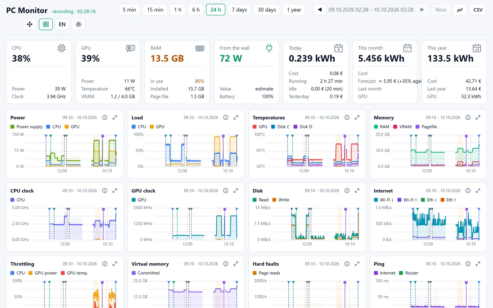
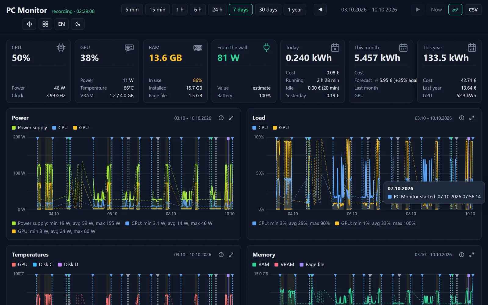
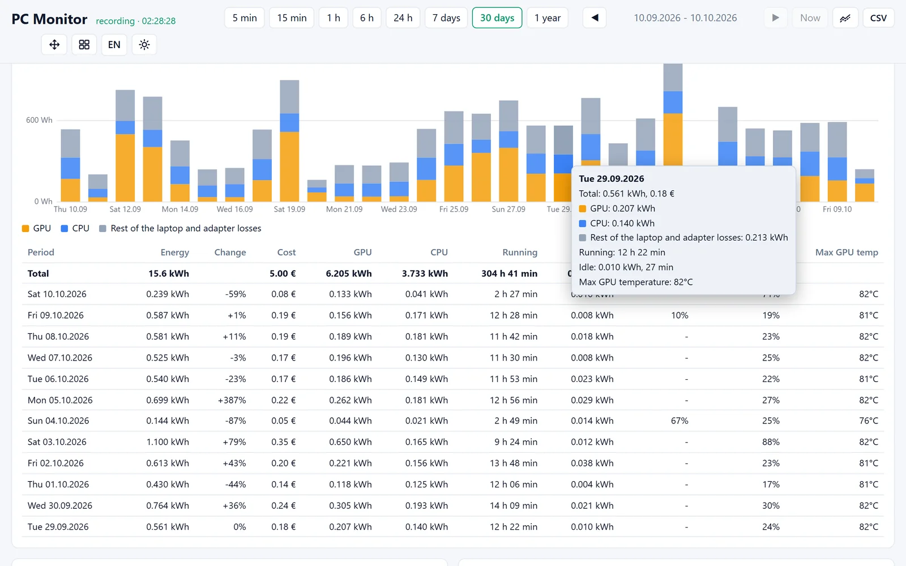
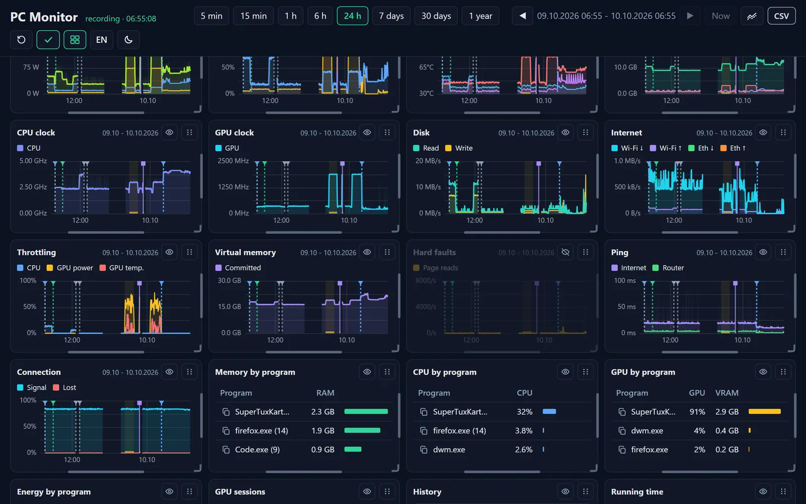

# PC Monitor


**How much power does your laptop really use?** PC Monitor runs in the background and records the load of the
processor, graphics card, memory and disks and the power drawn from the wall, with its cost. You see it all in a
local dashboard in your browser: from the last five minutes to a whole year.

**[Download the latest version](https://github.com/arturslab/pc-monitor-releases/releases/latest)** ·
[Program page](https://tools.melma.pl/pc-monitor/en/) · [Strona po polsku](https://tools.melma.pl/pc-monitor/)



## Features

- **Recording in the background, no administrator rights.** A reading every 2 seconds: CPU (load, power, clock,
  limits), NVIDIA GPU (load, temperature, power, VRAM, why its clock is held down), RAM, page file, disks and their
  temperatures, Wi-Fi and ping, battery. Starts with Windows and lives in the notification area.
- **Charts from five minutes to a year.** Step through the history, compare with the previous period, enlarge a
  chart, hover to see the values on every chart at once.
- **Energy and cost.** kWh and money for today, the month and the year, a forecast for the month, the energy of each
  program and the idle time.
- **GPU sessions and history.** Games, image generation or renders found as sessions with their time, energy,
  temperature and throttling; starts, sleeps, power changes, notifications and notes in one list.
- **Notes on the charts.** Right-click a chart and write down what happened.
- **Your own layout.** Drag, resize and hide the cards; the compact and the normal view keep separate layouts.
- **Battery and drives.** Battery wear week by week, discharges and charges, NVMe drive health.
- **Notifications, backups, CSV export**, a weekly summary.
- **English and Polish, light and dark.**

| | |
|---|---|
|  |  |
|  | |

## Download and install

Each [release](https://github.com/arturslab/pc-monitor-releases/releases) has two files:

| File | What it is |
|---|---|
| `PC-Monitor-Setup-<version>.exe` | The installer. Installs for the current user, without administrator rights; a newer version updates the program and keeps the data. Uninstall from Windows Settings, Apps (it asks whether to delete the recorded data). |
| `PC-Monitor-<version>-portable.zip` | No installation: unpack it anywhere and start `PC Monitor.exe`. It keeps its data in the `data` folder next to it. |

The program runs in the notification area; its icon opens the dashboard at `http://127.0.0.1:8765/`.

**Requirements:** Windows 10 or 11, 64-bit. An NVIDIA card is optional (GPU readings). Best on a laptop: on battery
it learns the draw of the rest of the hardware, which makes the wall estimate accurate.

**SmartScreen:** the files are not signed with a certificate, so Windows may say "Windows protected your PC". Choose
"More info" and "Run anyway". You can check a file first against `SHA256SUMS.txt` of its release:

```powershell
Get-FileHash .\PC-Monitor-Setup-1.14.1.exe -Algorithm SHA256
```

**More sensors (optional):** CPU temperature and fans need a kernel driver, so PC Monitor reads them from
[LibreHardwareMonitor](https://github.com/LibreHardwareMonitor/LibreHardwareMonitor) run as administrator with its
Remote Web Server on. Deny its firewall prompt and turn on its authentication.

## Privacy and security

- The data stays on your computer, in an SQLite database. No telemetry, no account.
- The dashboard is served only at 127.0.0.1 (not reachable from the network) and checks the Host header against DNS
  rebinding.
- No administrator rights and no drivers of its own.
- The network quality measurement pings your router and the address set in the settings (1.1.1.1 by default).

## How the power from the wall is estimated

The processor and the NVIDIA card report their own power. The rest of the laptop (screen, board, drives) is learned
on battery, where Windows reports the real draw; the conversion and adapter losses are added. Without a wall meter
the result is an estimate, usually close enough to see what costs what.

## Licence

PC Monitor is freeware by Artur Słaboszewski: free for private and commercial use; you may pass on the unmodified
files free of charge. See [LICENSE.txt](LICENSE.txt) ([LICENCJA.txt](LICENCJA.txt) in Polish). The bundled
third-party components keep their own licences, listed in [THIRD-PARTY-NOTICES.md](THIRD-PARTY-NOTICES.md).

This repository holds the releases and the documentation; the source code is not published.
Changes: [CHANGELOG.md](CHANGELOG.md).

## Po polsku

PC Monitor to darmowy program dla Windows, który w tle zapisuje obciążenie procesora, karty graficznej, pamięci
i dysków oraz pobór energii z gniazdka, razem z kosztem, i pokazuje je w lokalnym panelu w przeglądarce: od 5 minut
do roku. Bez uprawnień administratora i bez telemetrii. Pobierz instalator lub wersję portable z
[ostatniego wydania](https://github.com/arturslab/pc-monitor-releases/releases/latest); opis, zrzuty ekranu i film:
[tools.melma.pl/pc-monitor](https://tools.melma.pl/pc-monitor/). Licencja: [LICENCJA.txt](LICENCJA.txt).
